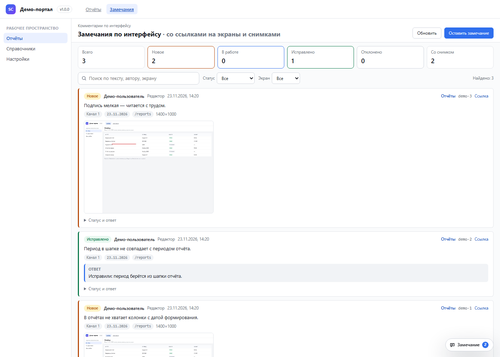

# Site Commenter

Комментарии по интерфейсу: оператор обводит проблемное место прямо на экране
(стрелка, подчёркивание, обводка, надпись), пишет замечание — и всё вместе со
снимком уходит на сервер. Замечания собираются в реестре со ссылками на экраны.

Два способа поставить:

- **встроенный модуль** — React-компоненты в вашем приложении;
- **расширение Chrome** — работает поверх любого сайта, снимок нативный
  (`captureVisibleTab`), интеграция в код не нужна.

```
src/          React-клиент (окно, разметка, снимок, реестр)
server/       эталонный сервер: HTTP API + таблица (Go, database/sql)
extension/    расширение Chrome, использует тот же клиент
demo/         демо-страница с вымышленными данными (источник скриншотов)
examples/     пример подключения
```




## Возможности

- Плавающая кнопка «Замечание» со счётчиком открытых замечаний; её можно
  перетащить в любое место экрана — позиция запоминается.
- Разметка поверх экрана: **стрелка, подчёркивание, обводка, надпись**, четыре
  цвета, отмена и очистка; надпись многострочная (`Enter` — перенос,
  `Ctrl+Enter` — поставить).
- Снимок видимой области **вместе с разметкой** (JPEG): во встроенном модуле —
  рендер DOM, в расширении — нативный снимок вкладки.
- Позиции прокрутки панелей сохраняются.
- Отправка текста, снимка и контекста (экран, канал, дата) одним запросом;
  текст может быть пустым, если приложен снимок.
- Реестр (необязательный): фильтры, снимки, статусы «Новое / В работе /
  Исправлено / Отклонено», ответ модератора и ссылка на конкретное замечание
  `/#/comments?comment=<id>` для чата и агента.

## Быстрый старт

```bash
npm install html-to-image
```

```tsx
import {
  UiCommentsProvider,
  UiCommentsWidget,
  UiCommentsRegistry,
  createUiCommentsApi,
} from "./ui-comments/src";
import "./ui-comments/src/styles.css";

const api = createUiCommentsApi({ basePath: "/api/v1/ui-comments" });

export function App() {
  return (
    <UiCommentsProvider
      config={{
        api,
        user: currentUser, // { username, name?, role?, isAdmin? }
        context: {
          route: location.pathname,
          routeTitle: screenTitle(location.pathname),
          url: window.location.href,
          channelName: currentChannel?.name,
          date: currentDay,
        },
        captureRoot: "#root",
      }}
    >
      <Routes />
      <UiCommentsWidget />
    </UiCommentsProvider>
  );
}
```

Реестр — отдельным маршрутом: `<UiCommentsRegistry />`.

Подробности — [`src/README.md`](src/README.md): настройки провайдера, контракт
API, разметка, темы и ограничения.

## Расширение Chrome

Собранное расширение лежит в `extension/dist` и работает без интеграции в
приложение:

```bash
npm install            # react, esbuild, типы
npm run build:extension
```

Затем `chrome://extensions` → «Режим разработчика» → «Загрузить распакованное»
→ выбрать `extension/dist`. Подробности и публикация — [`extension/README.md`](extension/README.md).

В расширении снимок делает браузер (`chrome.tabs.captureVisibleTab`), поэтому
в кадр попадают видео, canvas и iframe, а панель замечания на момент съёмки
скрывается. Если на странице уже есть встроенный модуль, расширение не ставит
второй виджет (метка `data-ui-comments-inline`).

## Демо

```bash
npm install
npm run demo          # http://127.0.0.1:5173
```

Демо-страница с вымышленными данными: замечания хранятся в памяти, сервер не
нужен. Из неё сняты скриншоты выше — подробности в [`demo/README.md`](demo/README.md).

## Сервер

Два варианта:

1. **Готовый пакет `server/`** (Go + SQLite) — компилируется в бинарник хоста,
   отдельного сервиса не нужно. Подключение — [`server/README.md`](server/README.md).
2. **Свой бэкенд** — реализуйте пять маршрутов из контракта в `src/README.md`
   (список, создание, статус, удаление, снимок). Клиент не изменится; если
   формат ответа не `{"data": ...}`, реализуйте интерфейс `UiCommentsApi` вручную.

## Требования

- React 18+, браузер с поддержкой `foreignObject` (Chrome, Edge, Firefox;
  Safari — с ограничениями).
- `html-to-image` (MIT) для снимка; грузится динамическим импортом.

## Ограничения

- Снимается видимая область, а не весь документ.
- Разметка привязана к координатам экрана: после прокрутки она останется на
  месте. На время рисования прокрутка блокируется.
- Разметка «запекается» в JPEG; отдельно векторные данные не хранятся.

## Лицензия

MIT — см. [`LICENSE`](LICENSE).
